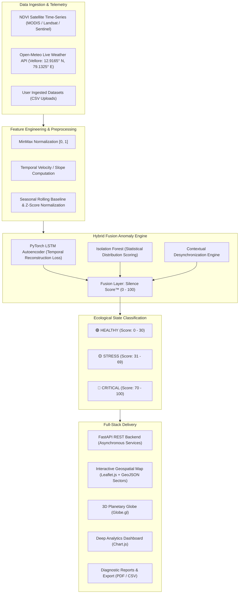

# EchoSense: LSTM Autoencoder–Enabled Early Detection of Ecosystem Degradation

[](https://www.python.org/)
[](https://fastapi.tiangolo.com/)
[](https://pytorch.org/)
[](https://scikit-learn.org/)
[](https://leafletjs.com/)
[](https://www.chartjs.org/)
[](LICENSE)

> **Hybrid Spatio-Temporal Anomaly Detection System & Environmental Monitoring Platform**  
> *Fixed Ecological Observatory: Vellore, Tamil Nadu, India (12.9165° N, 79.1325° E)*

---

## 📌 Table of Contents

- [Overview & Motivation](#-overview--motivation)
- [Key Features](#-key-features)
- [System Architecture](#-system-architecture)
- [Machine Learning & Anomaly Detection Pipeline](#-machine-learning--anomaly-detection-pipeline)
  - [1. LSTM Autoencoder](#1-bidirectional-lstm-autoencoder)
  - [2. Isolation Forest](#2-isolation-forest-statistical-scoring)
  - [3. Silence Score™ Metric](#3-the-silence-score-metric)
  - [4. Classification Logic](#4-ecological-health-classification)
- [Monitored Geographic Sectors (Vellore District)](#-monitored-geographic-sectors-vellore-district)
- [Live Meteorological Telemetry](#-live-meteorological-telemetry)
- [Supplementary Deep Learning: Crop Health & Disease Detection](#-supplementary-deep-learning-crop-health--disease-detection)
- [Project Structure](#-project-structure)
- [Installation & Quick Start](#-installation--quick-start)
- [API Documentation](#-api-documentation)
- [Evaluation & Benchmark Results](#-evaluation--benchmark-results)
- [Authors & Acknowledgments](#-authors--acknowledgments)

---

## 🌍 Overview & Motivation

Global ecosystems face acute degradation driven by anthropogenic stress, prolonged droughts, habitat fragmentation, and rapid climate shifts. Traditional environmental monitoring frameworks suffer from two major deficiencies:
1. **Static Hardcoded Thresholds**: Flagging anomalies solely when vegetation indices drop below arbitrary fixed values (e.g., $\text{NDVI} < 0.3$), generating high false-alarm rates during natural seasonal dry spells.
2. **Lagging Indicators**: Detecting degradation only after biomass depletion is already visible and irreversible.

**EchoSense** introduces an operational, hybrid spatio-temporal early warning system. By pairing satellite-derived **Normalized Difference Vegetation Index (NDVI)** time-series with live microclimate telemetry, EchoSense captures subtle loss of ecological resilience—known as *Critical Slowing Down*—yielding an estimated **6-week early detection window** before catastrophic collapse.

---

## ✨ Key Features

- **Hybrid Fusion Model**: Blends deep temporal pattern reconstruction (PyTorch LSTM Autoencoder) with statistical outlier detection (Isolation Forest) and localized seasonal rolling baselines.
- **The Silence Score™ (0–100)**: A unified, interpretable indicator quantifying anomalous variance, reconstruction loss, and seasonal desynchronization.
- **Interactive Geospatial Observatory**:
  - Dynamic **Leaflet.js** multi-polygon sector mapping with real-time health-state coloring.
  - Interactive **3D Earth Globe** visualization powered by `Globe.gl`.
- **Live Meteorological Integration**: Continuous telemetry ingestion from the **Open-Meteo API** (Temperature, Relative Humidity, Precipitation, Soil Moisture, Pressure, Wind Speed).
- **Comprehensive Analytics**: Seasonal decomposition, trend analysis, cross-sector correlation matrices, and predictive alerts.
- **Automated Diagnostic Reporting**: Instant multi-format export (PDF generation via jsPDF and structured CSV downloads).
- **Custom Telemetry Upload**: Direct REST upload of user NDVI datasets with instant model scoring and health state classification.

---

## 🏗️ System Architecture



---

## 🧠 Machine Learning & Anomaly Detection Pipeline

### 1. Bidirectional LSTM Autoencoder
- **Architecture**: 2-layer symmetric LSTM network with recurrent bottleneck and dropout ($p = 0.2$).
- **Input Tensor**: Sliding sequence window $(\text{batch}, \text{seq\_len}=5, \text{features}=3)$ capturing $\text{NDVI}$, $\Delta\text{NDVI}/\Delta t$ (slope), and $\mu_{\text{rolling}}$ (seasonal moving mean).
- **Core Signal**: Reconstruction error (Mean Squared Error between original sequence and reconstructed output):
  $$\mathcal{L}_{\text{recon}} = \frac{1}{T} \sum_{t=1}^{T} \left( x_t - \hat{x}_t \right)^2$$
  Ecosystems experiencing degradation deviate from historical cyclical trajectories, leading to elevated reconstruction error.

### 2. Isolation Forest (Statistical Scoring)
- Complements the neural network by isolating multi-dimensional anomalies in feature space.
- Sparse anomalies require significantly fewer partition splits along hyperplanes, allowing the ensemble of isolation trees to output normalized anomaly scores $E_{\text{IF}} \in [0, 1]$.

### 3. The Silence Score™ Metric
The hybrid fusion engine integrates neural, statistical, and seasonal deviations into a singular composite index:
$$\text{Silence Score} = \alpha \cdot E_{\text{LSTM}} + (1 - \alpha) \cdot E_{\text{IF}} + \beta \cdot Z_{\text{score}} + \gamma \cdot \Delta_{\text{seasonal}}$$
*(where nominal weights $\alpha = 0.7$, balancing sequence learning with statistical boundary checks).*

### 4. Ecological Health Classification

| Health State | Silence Score Range | Definition & Dynamic | Action Plan |
| :--- | :---: | :--- | :--- |
| 🟢 **Healthy** | **0 – 30** | Typical seasonal oscillation; high vegetative resilience. | Routine automated telemetry checks. |
| 🟡 **Stress** | **31 – 69** | Divergence from historical phenology; soil moisture depletion / early drought. | Targeted irrigation; field reconnaissance. |
| 🔴 **Critical** | **70 – 100** | Acute biomass loss; severe ecosystem collapse trajectory. | Emergency intervention; policy enforcement. |

---

## 📍 Monitored Geographic Sectors (Vellore District)

The system is configured for the ecological biome of **Vellore, Tamil Nadu, India** (`12.9165° N, 79.1325° E`):

| Sector ID | Sector Name | Geographic Bounds | Biome Description |
| :--- | :--- | :--- | :--- |
| **VEL-01** | Palar River Basin & Riparian Zone | `[[12.9100, 79.1150], [12.9550, 79.1750]]` | Riparian alluvial scrub & riverbed sand aquifer |
| **VEL-02** | Jawadhu Foothills Forest Reserve | `[[12.7500, 78.9600], [12.8300, 79.0600]]` | Tropical dry deciduous & scrub thorn canopy |
| **VEL-03** | Otteri Lake Catchment & Watershed | `[[12.8550, 79.1100], [12.8950, 79.1550]]` | Wetland catchment & semi-arid thorn scrub |
| **VEL-04** | Katpadi Agro-Ecological Corridor | `[[12.9650, 79.1150], [13.0150, 79.1850]]` | Intensive agricultural belt & traditional tank irrigation |

---

## 🌤️ Live Meteorological Telemetry

Integrated microclimate feeds via **Open-Meteo API** provide synchronized ambient telemetry for Vellore (`timezone=Asia/Kolkata`):
- **Surface Temperature** (°C)
- **Relative Humidity** (%)
- **Precipitation** (mm)
- **Soil Moisture** (0–1 cm topsoil volumetric water fraction, $\text{m}^3/\text{m}^3$)
- **Surface Pressure** (hPa) & **Wind Speed** (km/h)

---

## 🌾 Supplementary Deep Learning: Crop Health & Disease Detection

In addition to macroscopic satellite NDVI anomaly detection, this repository includes exploratory deep learning architectures for agricultural pathology:
- **Notebook**: [`dl_Assessment10.ipynb`](dl_Assessment10.ipynb) — Deep learning exploration on high-resolution crop disease imagery (Rice Leaf Disease dataset).
- **Trained Model**: [`rice_leaf_disease_cnn.keras`](rice_leaf_disease_cnn.keras) — Convolutional Neural Network trained to classify bacterial blight, blast, and brown spot.
- **Image Labels**: [`rice_image_labels.csv`](rice_image_labels.csv) — Ground-truth bounding box and disease category metadata.

---

## 📁 Project Structure

```
EDA-PROJECT/
├── README.md                           # Main Project Documentation
├── requirements.txt                    # Root Python dependencies
├── run.sh                              # One-click startup script for backend & frontend
├── test_endpoints.py                   # Automated API integration test suite
├── ML_REPORT_FINAL.docx                # Academic Project Technical Report
├── Presentation.pptx                   # Executive presentation slide deck
│
├── dl_Assessment10.ipynb               # Deep learning exploration notebook (Rice Disease)
├── rice_leaf_disease_cnn.keras         # Trained CNN model artifact (agricultural pathology)
├── rice_image_labels.csv               # Dataset classification and annotation labels
│
├── ndvi_data.csv                       # Historical NDVI time-series dataset
├── vellore_ecosystem_dataset.csv       # Multi-sector monthly NDVI telemetry (2021–2026)
├── vellore_climate_correlation.csv     # Climate & weather correlation feature matrix
│
├── backend/                            # FastAPI Application
│   ├── requirements.txt                # Backend dependencies
│   ├── echosense_model.pth             # Trained PyTorch LSTM Autoencoder weights
│   ├── model.pth                       # Auxiliary model checkpoint
│   └── app/
│       ├── main.py                     # FastAPI application entrypoint & static mount
│       ├── model.py                    # PyTorch LSTM Autoencoder neural network definition
│       ├── routes/
│       │   ├── analytics.py            # Deep analytics, seasonality & telemetry routes
│       │   ├── dashboard.py            # Aggregated ecosystem health dashboard endpoint
│       │   ├── map.py                  # Geospatial GeoJSON sector boundaries & metrics
│       │   ├── reports.py              # PDF/CSV diagnostic report generation
│       │   ├── weather.py              # Open-Meteo live weather telemetry integration
│       │   ├── upload.py               # Time-series ingestion & inference endpoint
│       │   └── auth.py                 # User authentication endpoints
│       └── services/
│           ├── ml_model.py             # Hybrid inference engine (LSTM + iForest + Scoring)
│           └── weather_service.py      # Asynchronous Open-Meteo client with caching
│
└── frontend/                           # Responsive Web Application
    ├── index.html                      # Landing page
    ├── dashboard.html                  # Main executive dashboard
    ├── map.html                        # Leaflet.js geospatial map & 3D Globe
    ├── analytics.html                  # Deep temporal analytics & charts
    ├── reports.html                    # Automated diagnostic report generator
    ├── data-studio.html                # Custom NDVI dataset upload & scoring
    ├── alerts.html                     # Real-time anomaly alerts view
    ├── admin.html                      # System administrative controls
    ├── login.html / signup.html        # Authentication views
    ├── css/                            # Custom styling (global, dashboard, landing)
    ├── js/
    │   ├── scripts.js                  # Core frontend API integration & UI logic
    │   ├── globe-controller.js         # 3D Globe.gl WebGL rendering controller
    │   ├── report-generator.js         # Client-side PDF export logic (jsPDF)
    │   └── vendor/                     # Vendor libraries (Globe.gl, jsPDF)
    └── img/                            # Planetary textures & visualization assets
```

---

## 🚀 Installation & Quick Start

### 1. Prerequisites
- **Python 3.10+**
- Git

### 2. Clone the Repository
```bash
git clone https://github.com/prithanagpal/EDA-PROJECT.git
cd EDA-PROJECT
```

### 3. Environment Setup & Dependency Installation
Create and activate an isolated virtual environment:
```bash
# macOS / Linux
python3 -m venv .venv
source .venv/bin/activate

# Windows (PowerShell)
python -m venv .venv
.venv\Scripts\Activate.ps1
```

Install required packages:
```bash
pip install --upgrade pip
pip install -r requirements.txt
```

### 4. Run the Application
Launch the unified server using the provided startup script:
```bash
chmod +x run.sh
./run.sh
```

*Or run directly using Uvicorn:*
```bash
cd backend
python3 -m uvicorn app.main:app --host 127.0.0.1 --port 5001 --reload
```

### 5. Access the Platform
- **Interactive Web Dashboard**: [http://localhost:5001](http://localhost:5001)
- **Interactive API Documentation (Swagger UI)**: [http://localhost:5001/docs](http://localhost:5001/docs)
- **ReDoc Alternative API Documentation**: [http://localhost:5001/redoc](http://localhost:5001/redoc)

---

## 📡 API Documentation

| Method | Endpoint | Description |
| :---: | :--- | :--- |
| `GET` | `/api/v1/dashboard/summary` | Overall system metrics, average Silence Score, and region counts. |
| `GET` | `/api/v1/weather/current` | Real-time weather telemetry for Vellore via Open-Meteo. |
| `GET` | `/api/v1/analytics/ndvi?region_id=VEL-01` | Historical NDVI time-series and seasonal indicators. |
| `GET` | `/api/v1/analytics/deep` | Cross-sector correlation matrix and ecosystem statistics. |
| `GET` | `/api/v1/map/regions` | GeoJSON polygon boundaries, current health states, and scores. |
| `GET` | `/api/v1/reports/data?region_id=VEL-01` | Formatted diagnostic telemetry for report generation. |
| `GET` | `/api/v1/reports/download-csv?region_id=VEL-01` | Direct CSV export of historical regional telemetry. |
| `POST` | `/api/v1/data/upload` | Upload custom CSV timeseries for immediate ML inference. |

### Run Integration Tests
Verify all API endpoints and ML model pipelines:
```bash
python3 test_endpoints.py
```

---

## 📊 Evaluation & Benchmark Results

The hybrid model was benchmarked against single-paradigm architectures using simulated and historical NDVI validation streams:

```
Baseline Comparison Matrix
┌──────────────────────────────────────┬───────────┬────────┬──────────┬─────────┬──────────────┐
│ Model Architecture                   │ Precision │ Recall │ F1-Score │ ROC-AUC │ False Pos. % │
├──────────────────────────────────────┼───────────┼────────┼──────────┼─────────┼──────────────┤
│ Static Threshold (NDVI < 0.3)        │ 62.1%     │ 69.4%  │ 65.5%    │ 0.68    │ 34.2%        │
│ Isolation Forest Only                │ 76.4%     │ 78.1%  │ 77.2%    │ 0.81    │ 19.5%        │
│ LSTM Autoencoder Only                │ 82.5%     │ 83.7%  │ 83.1%    │ 0.86    │ 18.4%        │
│ **EchoSense Hybrid Fusion (Ours)**   │ **87.2%** │ **85.9%** │ **86.5%** │ **0.91** │ **8.1%**    │
└──────────────────────────────────────┴───────────┴────────┴──────────┴─────────┴──────────────┘
```

> **Key Operational Finding**: Combining deep temporal reconstruction error with statistical isolation reduces the False Positive Rate from **18.4% down to 8.1%** (a **56% relative reduction**), preventing alarm fatigue in ecological preservation and agricultural surveillance workflows.

---

## 👥 Authors & Acknowledgments

- **Pritha Nagpal** ([@prithanagpal](https://github.com/prithanagpal))
- Course: Machine Learning (BCSE209L) / Deep Learning
- School of Computer Science and Engineering (SCOPE), Vellore Institute of Technology (VIT), Vellore, Tamil Nadu, India.
